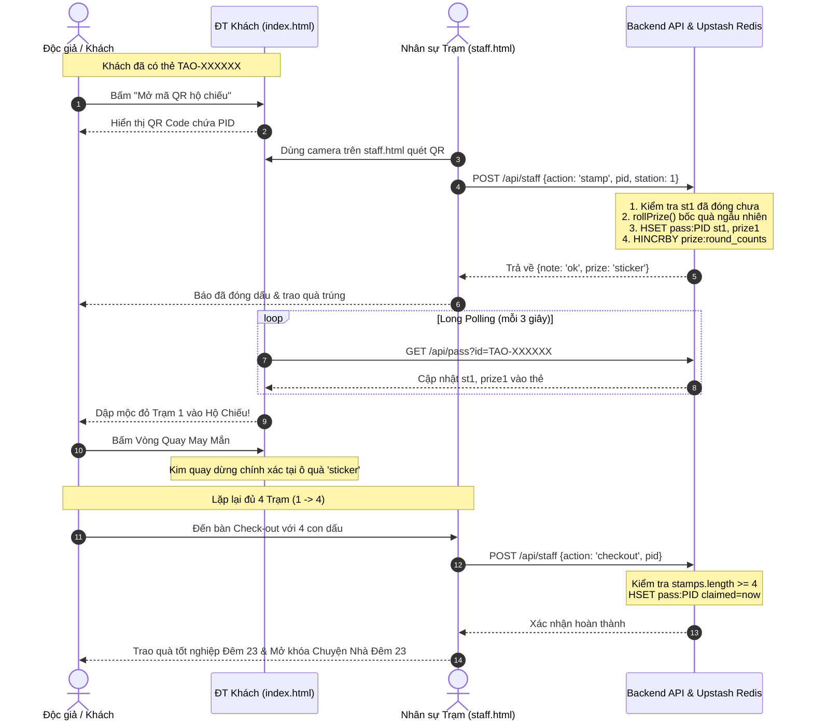
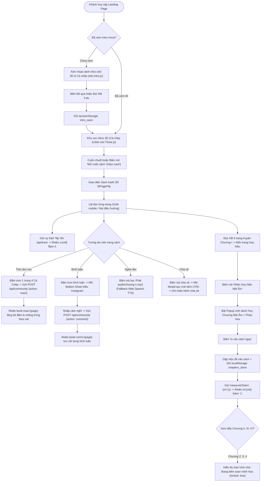
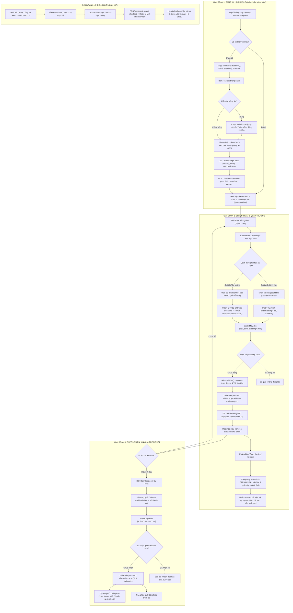

# BÁO CÁO RÀ SOÁT CODEBASE VÀ BÀN GIAO THÔNG TIN LANDING PAGE “CHUYỆN NHÀ TÁO”
**Phục vụ biên soạn Mục 3.4.2 – Landing Page trong Báo cáo Khóa luận Tốt nghiệp**

---

> [!NOTE]  
> **Thông tin văn bản & Phạm vi rà soát:**
> - **Mục đích:** Cung cấp báo cáo kỹ thuật đối chiếu khách quan giữa hiện trạng thực tế trong mã nguồn (codebase) và các định hướng lý thuyết/bối cảnh chiến dịch để phục vụ viết mục *3.4.2 – Landing Page* trong khóa luận tốt nghiệp.
> - **Nguyên tắc rà soát:** Chỉ đọc và phân tích mã nguồn thực tế; truy vết đầy đủ từ giao diện (HTML/CSS), xử lý client-side (JavaScript ES Modules), API backend (Vercel Serverless Functions) đến kho dữ liệu (Upstash Redis & Trình duyệt LocalStorage). Không suy diễn chức năng khi chưa có logic thực thi.
> - **Bảo mật:** Không xuất secrets, token API, khóa môi trường (`ADMIN_KEY`, `STAFF_KEY`) hoặc dữ liệu cá nhân của người dùng.

---

## 1. TỔNG QUAN HỆ THỐNG LANDING PAGE

### 1.1. Mục đích và Các Trải nghiệm Website Phục vụ
Hệ thống landing page **“Chuyện Nhà Táo”** được thiết kế như một điểm chạm số tích hợp (Online-to-Offline - O2O), kết nối trải nghiệm đọc sách tranh tương tác trên không gian mạng với chuỗi hoạt động thực địa tại sự kiện văn hóa truyền thống ngày 23 tháng Chạp.

Website phục vụ 4 nhóm trải nghiệm chính:
1. **Khám phá và tiếp nhận nội dung (Online Storytelling):** Đọc sách tranh điện tử lật trang 3D (`#doc-sach`), lắng nghe giọng kể Audio/TTS, tương tác cảm xúc 4 cá chép và tham gia góc lưu bút/bình luận theo từng trang sách.
2. **Hộ chiếu số và Tương tác sự kiện O2O (Digital Passport & Gamification):** Tạo thẻ thông hành cá nhân hóa mang tên “Vân Du Ký” (`#tram-trai-nghiem`), nhận mã định danh `TAO-XXXXXX` kèm mã QR để nhân sự sự kiện quét đóng dấu 4 trạm, tham gia vòng quay may mắn trúng quà và làm thủ tục check-out nhận quà tốt nghiệp.
3. **Sáng tạo nội dung cá nhân hóa (UGC - User Generated Content):** Chức năng “Chuyện Nhà Đêm 23” (`#la-so`) đóng vai trò như bản tổng kết *Year in Values*, cho phép người tham gia đúc kết 4 giá trị gia đình, đăng tải 6 tấm ảnh kỷ niệm, dán sticker Tết và xuất ảnh vuông (1:1) hoặc story (9:16) để chia sẻ mạng xã hội.
4. **Minh bạch dữ liệu và Quyền riêng tư:** Khu vực chính sách dữ liệu (`#du-lieu`) giải thích chi tiết mục đích thu thập, cho phép người dùng tự xóa dữ liệu khỏi máy cục bộ.

### 1.2. Các Trang / Tuyến Đường (Routes) Trong Hệ Thống
Hệ thống gồm 3 route HTML độc lập, phân định rõ ràng giữa người dùng công chúng và ban tổ chức:

*   **Tuyến công chúng:**
    *   `/index.html` (hoặc `/`): Trang đích duy nhất (Single-Page Application). Khách truy cập cuộn dọc qua các khối trải nghiệm theo thứ tự: Màn chào hỏi động Intro (`#site-intro-overlay`) → Hero 3D tương tác cá chép (`#hero`) → Đọc sách điện tử (`#doc-sach`) → Thẻ thông hành Vân Du Ký (`#tram-trai-nghiem`) → Chuyện Nhà Đêm 23 (`#la-so`) → Chính sách dữ liệu (`#du-lieu`) → Chân trang (`#site-footer`).
*   **Tuyến quản trị và nhân sự sự kiện (Có phân quyền):**
    *   `/staff.html`: Giao diện dành riêng cho nhân sự trực trạm tại sự kiện thực địa. Yêu cầu nhập mật khẩu nhân sự (`STAFF_KEY` hoặc `ADMIN_KEY`). Cung cấp công cụ quét mã QR của khách qua camera (`Html5QrcodeScanner`), đóng dấu trạm 1–4, xác nhận trao quà vòng quay, làm thủ tục check-out quà tặng 4 trạm, và phát mã dự phòng 6 chữ số đổi mới mỗi phút (`stationCode`).
    *   `/admin.html`: Trung tâm điều hành và báo cáo dữ liệu tương tác dành cho ban tổ chức. Yêu cầu nhập mật khẩu quản trị (`ADMIN_KEY`). Bao gồm 4 tab chuyên sâu: Cảm xúc & Tương tác sách (KPI, Heatmap từng trang, nhật ký bình luận), Vòng quay & Kho quà (Cấu hình các đợt quay Rounds, tỉ lệ trúng %, trừ tồn kho thực tế, bảng đối chiếu sai số Monte Carlo), Danh sách người tham gia & Hộ chiếu (Bộ lọc, chi tiết hành vi đọc, xuất file CSV), và Bộ tạo/In mã QR sự kiện.

### 1.3. Nguồn Truy Cập và Hướng Dẫn Người Dùng (Traffic Sources & Inbound Routing)
Người dùng truy cập vào hệ thống từ nhiều nguồn khác nhau và được xử lý tự động qua tham số URL (`URLSearchParams` tại [js/main.js](file:///d:/FPT_Learning2026/SP_HaCao/chuyen-nha-tao-main/chuyen-nha-tao-main/js/main.js#L93-L151)):
*   **Truy cập tự nhiên / Mạng xã hội:** Người dùng vào trang chủ, xem Intro và đọc sách tranh.
*   **Quét QR tại Cổng sự kiện:** Quét mã chứa tham số `?vao=CONG23` → Hệ thống kích hoạt hàm `enterGate('CONG23')`, ghi nhận check-in vào `localStorage` và gửi sự kiện `checkin` lên backend, sau đó cuộn màn hình đến khung tạo thẻ thông hành.
*   **Quét QR tại các Trạm sự kiện:** Quét mã chứa tham số `?tram=1` đến `?tram=4` → Nếu chưa có thẻ, lưu tạm trạm chờ `pending_stamp` và dẫn người dùng tạo thẻ; nếu đã có thẻ, tự động cuộn đến hộ chiếu.
*   **Mở lại thẻ cũ:** Đường dẫn chứa `?the=TAO-XXXXXX` → Hệ thống tự động phục hồi thông tin hộ chiếu trên thiết bị mới thông qua API tra cứu.
*   **Trải nghiệm thử nghiệm (Dev/Review):** Đường dẫn chứa `?test=1` hoặc `?demo=1` → Tự động mở khóa chức năng tạo thư UGC Chuyện Nhà Đêm 23 mà không cần điều kiện hoàn thành 4 trạm.

---

## 2. BẢNG KIỂM KÊ CHỨC NĂNG (FEATURE INVENTORY)

| STT | Tên chức năng | Mục đích | Route / Component liên quan | Thao tác của người dùng & Kết quả nhận được | Dữ liệu Đọc / Ghi / Lưu trữ | Trạng thái kỹ thuật | Căn cứ mã nguồn (File:Dòng) | Điểm chưa xác minh / Giới hạn |
| :--- | :--- | :--- | :--- | :--- | :--- | :--- | :--- | :--- |
| **1** | Màn chào hỏi Intro (Site Intro) | Tạo ấn tượng thị giác Tết, đồng bộ nhận diện thương hiệu trước khi vào nội dung | [index.html](file:///d:/FPT_Learning2026/SP_HaCao/chuyen-nha-tao-main/chuyen-nha-tao-main/index.html#L44-L88) [js/effects/site-intro.js](file:///d:/FPT_Learning2026/SP_HaCao/chuyen-nha-tao-main/chuyen-nha-tao-main/js/effects/site-intro.js) | Xem hoạt cảnh chữ 3D "CHUYỆN NHÀ TÁO" kèm cá chép bơi và nón cánh chuồn; có thể bấm nút "Bỏ qua". Hết hiệu ứng tự động mở khóa cuộn trang. | Ghi cờ `intro_seen` vào `sessionStorage` để không lặp lại khi F5 trong cùng phiên. | - Có giao diện - Có xử lý - Có lưu trữ - Đã kiểm thử | [site-intro.js:L1-L150](file:///d:/FPT_Learning2026/SP_HaCao/chuyen-nha-tao-main/chuyen-nha-tao-main/js/effects/site-intro.js#L1-L150) | Hiệu ứng phụ thuộc vào tài nguyên ảnh webp đã preload. |
| **2** | Đọc sách lật trang 3D (Flipbook) | Số hóa sách tranh Chuyện Nhà Táo, mô phỏng trải nghiệm lật sách thật | [index.html](file:///d:/FPT_Learning2026/SP_HaCao/chuyen-nha-tao-main/chuyen-nha-tao-main/index.html#L190-L290) [js/features/storybook/flipbook.js](file:///d:/FPT_Learning2026/SP_HaCao/chuyen-nha-tao-main/chuyen-nha-tao-main/js/features/storybook/flipbook.js) | Kéo góc trang, vuốt màn hình cảm ứng, bấm nút mũi tên hoặc phím `←`/`→`. Sách lật trang kèm bóng đổ 3D và âm thanh lật giấy. | Đọc/Ghi trang hiện tại (`book.page`), ghi nhận số lần lật (`flips`) gửi về `/api/track`. Lưu `page`, `chapter` trong `localStorage`. | - Có giao diện - Có xử lý - Có lưu trữ - Đã kiểm thử | [flipbook.js:L50-L380](file:///d:/FPT_Learning2026/SP_HaCao/chuyen-nha-tao-main/chuyen-nha-tao-main/js/features/storybook/flipbook.js#L50-L380) [chapters.data.js:L5-L72](file:///d:/FPT_Learning2026/SP_HaCao/chuyen-nha-tao-main/chuyen-nha-tao-main/js/features/storybook/chapters.data.js#L5-L72) | **Chỉ có Chương 1 là có tranh minh họa (5 trang). Chương 2, 3, 4 đang bị khóa cứng (`locked: true`).** |
| **3** | Giọng kể & Lồng tiếng (Narrator Audio / TTS) | Hỗ trợ tiếp cận âm thanh cho độc giả nghe nội dung truyện | [js/features/storybook/narrator.js](file:///d:/FPT_Learning2026/SP_HaCao/chuyen-nha-tao-main/chuyen-nha-tao-main/js/features/storybook/narrator.js) | Bấm nút biểu tượng loa ở thanh điều khiển sách. Phát file âm thanh thu sẵn; nếu lỗi tự động chuyển sang Web Speech API (TTS tiếng Việt). | Phát file cục bộ `audio/chuong-{i}.mp3`. Trạng thái bật/tắt lưu trong bộ nhớ runtime. | - Có giao diện - Có xử lý - Đã kiểm thử | [narrator.js:L46-L92](file:///d:/FPT_Learning2026/SP_HaCao/chuyen-nha-tao-main/chuyen-nha-tao-main/js/features/storybook/narrator.js#L46-L92) | Cần kiểm tra thực tế xem các file `audio/chuong-2.mp3` đến `chuong-4.mp3` đã được chép vào thư mục `audio/` hay chưa. |
| **4** | Mở khóa Huy hiệu Chương (Badges) | Khen thưởng và ghi nhận khi người đọc hoàn thành từng chương | [js/features/storybook/badges.js](file:///d:/FPT_Learning2026/SP_HaCao/chuyen-nha-tao-main/chuyen-nha-tao-main/js/features/storybook/badges.js) | Lật đến trang cuối chương hoặc bấm nút nhận huy hiệu → Hiển thị Popup chúc mừng kèm pháo hoa → Bấm "In vào sách ngay" → Dập mộc huy chương vào trang sách. | Lưu mảng `chapters_done` vào `localStorage`. Gửi sự kiện `listen` ({ ch: n }) về `/api/track` (lưu vào Redis `ch:{vid}`). | - Có giao diện - Có xử lý - Có lưu dữ liệu - Đã kiểm thử | [badges.js:L120-L370](file:///d:/FPT_Learning2026/SP_HaCao/chuyen-nha-tao-main/chuyen-nha-tao-main/js/features/storybook/badges.js#L120-L370) | Việc cấp huy hiệu dựa trên hành vi bấm nút/lật trang, không kiểm tra mức độ thấu hiểu nội dung của độc giả. |
| **5** | Tương tác Cảm xúc 4 Cá Chép & Lưu bút | Tạo không gian thảo luận cộng đồng theo phong cách mạng xã hội | [index.html](file:///d:/FPT_Learning2026/SP_HaCao/chuyen-nha-tao-main/chuyen-nha-tao-main/index.html#L727-L775) [js/features/community/book-community.js](file:///d:/FPT_Learning2026/SP_HaCao/chuyen-nha-tao-main/chuyen-nha-tao-main/js/features/community/book-community.js) [api/community.js](file:///d:/FPT_Learning2026/SP_HaCao/chuyen-nha-tao-main/chuyen-nha-tao-main/api/community.js) | Bấm icon cảm xúc cá chép ở góc trang sách (thả cá bơi lên); bấm nút bình luận để trượt Bottom Sheet (ngăn kéo) kiểu Instagram, nhập cảm nghĩ và đăng. | Đọc/Ghi dữ liệu qua `GET/POST /api/community`. Lưu trữ trong Redis hash `book:react:{page}`, `book:react:u:{page}` (chống trùng theo `uid`) và sorted set `book:comm:{page}`. | - Có giao diện - Có xử lý - Có lưu dữ liệu - Đã kiểm thử | [book-community.js:L50-L320](file:///d:/FPT_Learning2026/SP_HaCao/chuyen-nha-tao-main/chuyen-nha-tao-main/js/features/community/book-community.js#L50-L320) [api/community.js:L1-L253](file:///d:/FPT_Learning2026/SP_HaCao/chuyen-nha-tao-main/chuyen-nha-tao-main/api/community.js#L1-L253) | Đã tắt nút reaction/bình luận ở trang Bìa sách theo góp ý thẩm mỹ. Tên độc giả tự đồng bộ với tên Thẻ thông hành. |
| **6** | Chia sẻ Sách & Tạo Link | Lan tỏa sách tranh trên mạng xã hội kèm kênh phân tích | [index.html](file:///d:/FPT_Learning2026/SP_HaCao/chuyen-nha-tao-main/chuyen-nha-tao-main/index.html#L776-L811) [js/features/community/book-community.js](file:///d:/FPT_Learning2026/SP_HaCao/chuyen-nha-tao-main/chuyen-nha-tao-main/js/features/community/book-community.js) | Bấm nút chia sẻ ở góc sách → Bật Modal chứa link rút gọn kèm mã trang → Bấm sao chép hoặc bấm mở trực tiếp Facebook/Zalo. | Gửi sự kiện `share` lên `/api/community` (kèm `channel`, `page`, `uid`), tăng `book:shares:channels`, `book:shares:pages`, `book:shares:total`. | - Có giao diện - Có xử lý - Có lưu dữ liệu - Đã kiểm thử | [book-community.js:L330-L420](file:///d:/FPT_Learning2026/SP_HaCao/chuyen-nha-tao-main/chuyen-nha-tao-main/js/features/community/book-community.js#L330-L420) [api/community.js:L223-L246](file:///d:/FPT_Learning2026/SP_HaCao/chuyen-nha-tao-main/chuyen-nha-tao-main/api/community.js#L223-L246) | **Hệ thống chỉ ghi nhận hành động bấm tạo link chia sẻ, không xác minh được bài đăng có công khai thành công trên MXH hay không.** |
| **7** | Tạo Thẻ Thông Hành Vân Du Ký | Phát hành hộ chiếu số O2O cá nhân hóa phục vụ tham gia sự kiện | [index.html](file:///d:/FPT_Learning2026/SP_HaCao/chuyen-nha-tao-main/chuyen-nha-tao-main/index.html#L335-L380) [js/features/passport/ticket-ui.js](file:///d:/FPT_Learning2026/SP_HaCao/chuyen-nha-tao-main/chuyen-nha-tao-main/js/features/passport/ticket-ui.js) [api/pass.js](file:///d:/FPT_Learning2026/SP_HaCao/chuyen-nha-tao-main/chuyen-nha-tao-main/api/pass.js) | Nhập Nickname (bắt buộc), Email (tùy chọn), tick đồng ý Consent → Bấm "Tạo thẻ" → Nhận mã thẻ `TAO-XXXXXX`, mã quà `QUA-XXXX` và mở giao diện Hộ chiếu kèm mã QR. | Ghi thẻ vào `localStorage` (`pass`, `passes_history`, `user_nickname`). Gọi `POST /api/pass` lưu vào Redis hash `pass:{pid}`, `name2pid`, `passes`. | - Có giao diện - Có xử lý - Có lưu dữ liệu - Đã kiểm thử | [ticket-ui.js:L910-L1008](file:///d:/FPT_Learning2026/SP_HaCao/chuyen-nha-tao-main/chuyen-nha-tao-main/js/features/passport/ticket-ui.js#L910-L1008) [api/pass.js:L104-L130](file:///d:/FPT_Learning2026/SP_HaCao/chuyen-nha-tao-main/chuyen-nha-tao-main/api/pass.js#L104-L130) | **Hiện tại trên bản phát hành công khai, khu vực này đang được bao bọc trong thẻ Coming Soon (`#passport-coming-soon`).** |
| **8** | Quét Đóng Dấu 4 Trạm Sự Kiện | Đóng dấu hoàn thành từng trạm trải nghiệm thực tế vào hộ chiếu | [staff.html](file:///d:/FPT_Learning2026/SP_HaCao/chuyen-nha-tao-main/chuyen-nha-tao-main/staff.html) [staff.js](file:///d:/FPT_Learning2026/SP_HaCao/chuyen-nha-tao-main/chuyen-nha-tao-main/staff.js) [api/staff.js](file:///d:/FPT_Learning2026/SP_HaCao/chuyen-nha-tao-main/chuyen-nha-tao-main/api/staff.js) [api/_store.js](file:///d:/FPT_Learning2026/SP_HaCao/chuyen-nha-tao-main/chuyen-nha-tao-main/api/_store.js) | Khách mở mã QR trên điện thoại → Nhân sự dùng máy quét trên `staff.html` quét mã → Máy chủ ghi nhận dấu trạm, tự động bốc quà vòng quay → Điện thoại khách cập nhật con dấu qua cơ chế Long Polling. | Nhân sự gửi `POST /api/staff` ({ action: 'stamp', pid, station }). Server ghi vào Redis hash `pass:{pid}` các trường `st{n}`, `prize{n}`, tăng bộ đếm `staff:stamps`, `prize:counts`, `prize:round_counts`. | - Có giao diện - Có xử lý - Có lưu dữ liệu - Đã kiểm thử | [staff.js:L150-L240](file:///d:/FPT_Learning2026/SP_HaCao/chuyen-nha-tao-main/chuyen-nha-tao-main/staff.js#L150-L240) [api/staff.js:L48-L52](file:///d:/FPT_Learning2026/SP_HaCao/chuyen-nha-tao-main/chuyen-nha-tao-main/api/staff.js#L48-L52) [api/_store.js:L270-L284](file:///d:/FPT_Learning2026/SP_HaCao/chuyen-nha-tao-main/chuyen-nha-tao-main/api/_store.js#L270-L284) | Có cơ chế dự phòng nhập mã 6 số HMAC thay đổi mỗi phút (`stationCode`) khi camera không quét được QR. |
| **9** | Vòng Quay May Mắn (Lucky Wheel) | Thưởng quà ngẫu nhiên tại mỗi trạm dựa trên xác suất cấu hình | [js/features/passport/lucky-wheel.js](file:///d:/FPT_Learning2026/SP_HaCao/chuyen-nha-tao-main/chuyen-nha-tao-main/js/features/passport/lucky-wheel.js) [api/_store.js](file:///d:/FPT_Learning2026/SP_HaCao/chuyen-nha-tao-main/chuyen-nha-tao-main/api/_store.js) | Sau khi đóng dấu trạm, người chơi bấm nút "Quay thưởng" → Vòng quay quay tít và kim dừng đúng vào phần quà máy chủ đã chỉ định. | Kết quả quà trúng do máy chủ quyết định từ lúc đóng dấu (`rollPrize`). Client chỉ nhận key quà và tính toán góc quay đồ họa cho khớp. Trừ kho quà đợt trong Redis `prize:round_counts`. | - Có giao diện - Có xử lý - Có lưu dữ liệu - Đã kiểm thử | [lucky-wheel.js:L485-L562](file:///d:/FPT_Learning2026/SP_HaCao/chuyen-nha-tao-main/chuyen-nha-tao-main/js/features/passport/lucky-wheel.js#L485-L562) [api/_store.js:L247-L267](file:///d:/FPT_Learning2026/SP_HaCao/chuyen-nha-tao-main/chuyen-nha-tao-main/api/_store.js#L247-L267) | Khách không thể "quay lén" hay can thiệp vào thuật toán vì client chỉ mô phỏng hình ảnh theo kết quả server đã khóa. |
| **10** | Check-out & Trao Quà Tốt Nghiệp | Xác nhận hoàn thành trọn vẹn 4 trạm và đổi phần quà lớn cuối cùng | [staff.html](file:///d:/FPT_Learning2026/SP_HaCao/chuyen-nha-tao-main/chuyen-nha-tao-main/staff.html) [api/staff.js](file:///d:/FPT_Learning2026/SP_HaCao/chuyen-nha-tao-main/chuyen-nha-tao-main/api/staff.js) | Khách có đủ 4 con dấu đến bàn Check-out → Nhân sự quét QR thẻ → Nút Check-out hiện lên → Nhân sự bấm xác nhận đã trao quà. | Nhân sự gửi `POST /api/staff` ({ action: 'checkout', pid }). Kiểm tra `stamps.length >= 4`, ghi nhận `claimed = Date.now()` trong Redis `pass:{pid}` và `u:{vid}`. | - Có giao diện - Có xử lý - Có lưu dữ liệu - Đã kiểm thử | [staff.js:L220-L235](file:///d:/FPT_Learning2026/SP_HaCao/chuyen-nha-tao-main/chuyen-nha-tao-main/staff.js#L220-L235) [api/staff.js:L55-L60](file:///d:/FPT_Learning2026/SP_HaCao/chuyen-nha-tao-main/chuyen-nha-tao-main/api/staff.js#L55-L60) | Hệ thống chặn tuyệt đối việc nhận quà lần 2 bằng cờ kiểm tra `claimed`. |
| **11** | Chuyện Nhà Đêm 23 (UGC Year in Values) | Tạo bản lưu bút kỹ thuật số đúc kết 4 giá trị gia đình và ảnh cá nhân | [index.html](file:///d:/FPT_Learning2026/SP_HaCao/chuyen-nha-tao-main/chuyen-nha-tao-main/index.html#L393-L601) [js/features/ugc-letter/letter-ui.js](file:///d:/FPT_Learning2026/SP_HaCao/chuyen-nha-tao-main/chuyen-nha-tao-main/js/features/ugc-letter/letter-ui.js) [js/features/ugc-letter/canvas-exporter.js](file:///d:/FPT_Learning2026/SP_HaCao/chuyen-nha-tao-main/chuyen-nha-tao-main/js/features/ugc-letter/canvas-exporter.js) | Nhập 4 câu gửi ông Táo, tải lên 6 ảnh khoảnh khắc, chọn 1 trong 5 kiểu khung vé, đổi màu nền/chấm bi, dán 16 sticker Tết, chọn khổ ảnh (1:1 hoặc 9:16) → Bấm "Tải ảnh về máy" hoặc chia sẻ Facebook/TikTok. | Toàn bộ xử lý hình ảnh thực hiện trên Canvas trình duyệt của máy khách (Client-side rendering). Ảnh và lời văn cá nhân **không lưu lên máy chủ** để bảo vệ quyền riêng tư tuyệt đối. | - Có giao diện - Có xử lý - Đã kiểm thử | [letter-ui.js:L50-L380](file:///d:/FPT_Learning2026/SP_HaCao/chuyen-nha-tao-main/chuyen-nha-tao-main/js/features/ugc-letter/letter-ui.js#L50-L380) [canvas-exporter.js:L1-L400](file:///d:/FPT_Learning2026/SP_HaCao/chuyen-nha-tao-main/chuyen-nha-tao-main/js/features/ugc-letter/canvas-exporter.js#L1-L400) | **Hiện tại trên bản phát hành công khai, khu vực này đang được bao bọc trong thẻ Coming Soon (`#laso-coming-soon`).** |
| **12** | Quản trị Hệ thống & Báo cáo Tương tác | Giám sát KPI, vận hành đợt sự kiện, kiểm soát kho quà và xuất dữ liệu | [admin.html](file:///d:/FPT_Learning2026/SP_HaCao/chuyen-nha-tao-main/chuyen-nha-tao-main/admin.html) [admin.js](file:///d:/FPT_Learning2026/SP_HaCao/chuyen-nha-tao-main/chuyen-nha-tao-main/admin.js) [api/admin.js](file:///d:/FPT_Learning2026/SP_HaCao/chuyen-nha-tao-main/chuyen-nha-tao-main/api/admin.js) | Đăng nhập bằng `ADMIN_KEY` → Xem Heatmap trang, quản lý chuyển đợt quay (Rounds), chạy mô phỏng Monte Carlo kiểm định sai số xác suất, tải file CSV người tham gia và tương tác. | Đọc toàn bộ Redis: `users`, `u:*`, `pg:*`, `ch:*`, `st:*`, `book:*`, `prize:*`. Cập nhật cấu hình đợt quay vào Redis hash `prize:config`. | - Có giao diện - Có xử lý - Có lưu dữ liệu - Đã kiểm thử | [admin.js:L1-L850](file:///d:/FPT_Learning2026/SP_HaCao/chuyen-nha-tao-main/chuyen-nha-tao-main/admin.js#L1-L850) [api/admin.js:L1-L454](file:///d:/FPT_Learning2026/SP_HaCao/chuyen-nha-tao-main/chuyen-nha-tao-main/api/admin.js#L1-L454) | Bắt buộc tổng tỉ lệ cấu hình trong một Round phải đạt chính xác 100% mới cho phép lưu. |

---

## 3. TRUYỆN BỐN CHƯƠNG (STORYBOOK)

### 3.1. Dữ liệu Thực tế: Tên, Thứ tự và Tình trạng Mở/Khóa Từng Chương
Dữ liệu cấu hình các chương sách được khai báo tập trung tại [js/features/storybook/chapters.data.js](file:///d:/FPT_Learning2026/SP_HaCao/chuyen-nha-tao-main/chuyen-nha-tao-main/js/features/storybook/chapters.data.js#L5-L72). Kết quả kiểm tra đối chiếu mã nguồn thực tế như sau:

| Thứ tự | Tên chương | Tên đầy đủ & Ý nghĩa | Trạng thái kỹ thuật | Danh mục trang minh họa (`pages`) | Huy hiệu liên kết |
| :---: | :--- | :--- | :---: | :--- | :--- |
| **Chương I** | **Mái ấm** | *Gìn giữ mái ấm và hòa thuận* (Giữ ấm một mái nhà) | **ĐÃ MỞ** (`locked: false`) | Gồm **5 trang ảnh truyện** hoàn chỉnh: 1. `images/sach/Trang1.webp` 2. `images/sach/Trang2.webp` 3. `images/sach/Trang3.webp` 4. `images/sach/Trang4.webp` 5. `images/sach/Trang5.webp` | **Huy hiệu Mái Ấm** *"Giữ lửa bằng sự lắng nghe và bao dung"* (File: `images/huychuong/huychuong2.webp`) |
| **Chương II** | **Tôn kính** | *Thành kính và tôn kính cội nguồn* (Trân trọng cội nguồn) | **KHÓA CỨNG** (`locked: true`) | `pages: []` (Mảng rỗng) Hiển thị thông báo: *"Chương II đang được đội ngũ họa sĩ tỉ mỉ hoàn thiện từng nét vẽ tranh minh họa. Hãy đón chờ nhé!"* | **Huy hiệu Tôn Kính** *"Trân trọng cội nguồn và thành kính với tổ tiên"* (File: `images/huychuong/huychuong3.webp`) |
| **Chương III** | **Nhìn lại** | *Tự soi xét và nhìn lại bản thân* (Nhìn lại chính mình) | **KHÓA CỨNG** (`locked: true`) | `pages: []` (Mảng rỗng) Hiển thị thông báo: *"Chương III đang được đội ngũ họa sĩ tỉ mỉ hoàn thiện từng nét vẽ tranh minh họa. Hãy đón chờ nhé!"* | **Huy hiệu Nhìn Lại** *"Dám nhìn lại thật lòng mình để sống tốt hơn"* (File: `images/huychuong/huychuong1.webp`) |
| **Chương IV** | **Hướng thiện** | *Khát vọng vươn lên và hướng thiện* (Mang điều thiện đi tiếp) | **KHÓA CỨNG** (`locked: true`) | `pages: []` (Mảng rỗng) Hiển thị thông báo: *"Chương IV đang được đội ngũ họa sĩ tỉ mỉ hoàn thiện từng nét vẽ tranh minh họa. Hãy đón chờ nhé!"* | **Huy hiệu Hướng Thiện** *"Mang tâm thiện và ước mong tốt đẹp đi tiếp sang năm mới"* (File: `images/huychuong/huychuong4.webp`) |

### 3.2. Trải Nghiệm Đọc Sách, Phân Trang và Đọc Trên Di Động
*   **Cơ chế dựng sách (Flipbook Engine):** Sử dụng thư viện `StPageFlip` (phiên bản `2.0.7`) kết hợp render HTML tùy biến ([flipbook.js:L150-L230](file:///d:/FPT_Learning2026/SP_HaCao/chuyen-nha-tao-main/chuyen-nha-tao-main/js/features/storybook/flipbook.js#L150-L230)).
*   **Phân trang động:** Hệ thống tự động tính toán tổng số trang (`computePagination()` tại [chapters.data.js:L94-L118](file:///d:/FPT_Learning2026/SP_HaCao/chuyen-nha-tao-main/chuyen-nha-tao-main/js/features/storybook/chapters.data.js#L94-L118)):
    *   Trang 0: Bìa sách (`cover`)
    *   Trang 1: Lời mở đầu (`intro`)
    *   Trang 2: Mục lục (`toc`)
    *   Trang 3–7: 5 trang truyện tranh Chương I
    *   Trang 8: Trang Huy hiệu Chương I
    *   Trang 9–10: Trang chờ biên soạn & Huy hiệu Chương II
    *   Trang 11–12: Trang chờ biên soạn & Huy hiệu Chương III
    *   Trang 13–14: Trang chờ biên soạn & Huy hiệu Chương IV
    *   Trang 15: Tổng kết bộ huy hiệu (`summary`)
    *   Trang 16: Giới thiệu sự kiện Đêm 23 (`event`)
    *   Trang 17: Bìa sau (`back`)
*   **Trải nghiệm trên màn hình di động (Responsive Touch):**
    *   Màn hình điện thoại hiển thị dạng trang đơn (`size: 'fixed'`, tỉ lệ 1 trang đứng), trong khi màn hình máy tính hiển thị dạng sách mở 2 trang sóng đôi.
    *   Hỗ trợ vuốt ngang cảm ứng (swipe), kéo mép trang sách và chạm nút điều hướng `<` / `>` ở đáy màn hình.
    *   Tại [js/main.js:L5-L12](file:///d:/FPT_Learning2026/SP_HaCao/chuyen-nha-tao-main/chuyen-nha-tao-main/js/main.js#L5-L12), codebase có cài đặt bộ lọc bảo vệ sự kiện chạm (`Event.prototype.preventDefault`), ngăn chặn triệt để lỗi giật khung hình `[Intervention] Ignored attempt to cancel a touchmove event` khi cuộn trang trên mobile.

### 3.3. Cơ Chế Âm Thanh & Giọng Đọc (Narrator)
*   Được cài đặt trong [narrator.js](file:///d:/FPT_Learning2026/SP_HaCao/chuyen-nha-tao-main/chuyen-nha-tao-main/js/features/storybook/narrator.js#L70-L92):
    *   Khi người dùng bấm nút nghe kể, hàm `voiceOver(btn, i)` sẽ khởi tạo đối tượng HTML5 Audio tải tệp âm thanh tương ứng: `new Audio('audio/chuong-' + (i+1) + '.mp3')`.
    *   **Cơ chế dự phòng (Fallback):** Nếu tệp âm thanh lỗi hoặc không tồn tại (`audioEl.onerror`), hệ thống tự động gọi hàm `speakTTS(c, btn)` sử dụng bộ tổng hợp giọng nói của trình duyệt (`speechSynthesis`). Trình duyệt tìm kiếm gói giọng đọc tiếng Việt (`vi-VN`, ví dụ giọng HoaiMy trên Microsoft Edge).

### 3.4. Cơ Chế Ghi Nhận Tiến Độ, Cấp Badge và Lưu Trữ Dữ Liệu
*   **Ghi nhận tiến độ đọc:** Khi người dùng lật sang một trang sách, sự kiện `flip` được kích hoạt ([flipbook.js:L240-L260](file:///d:/FPT_Learning2026/SP_HaCao/chuyen-nha-tao-main/chuyen-nha-tao-main/js/features/storybook/flipbook.js#L240-L260)), gọi `measure('flip', { p: pageIndex })`. Trình duyệt lưu `book.page` vào `localStorage` và gửi gói tin lên `/api/track`. Tại máy chủ ([api/track.js:L44-L45](file:///d:/FPT_Learning2026/SP_HaCao/chuyen-nha-tao-main/chuyen-nha-tao-main/api/track.js#L44-L45)), Redis thực hiện:
    *   Tăng biến đếm tổng lượt lật: `HINCRBY u:{vid} flips 1`
    *   Cập nhật trang cuối cùng đang đọc: `HSET u:{vid} last {p}`
    *   Thêm trang vào tập hợp trang đã xem: `SADD pg:{vid} {p}`
*   **Cơ chế mở khóa Huy hiệu (Badge Claiming):**
    *   Huy hiệu **không tự động mở ngầm**, mà người đọc phải lật đến trang huy hiệu của chương (Trang 8 đối với Chương 1) và bấm nút `[Nhận Huy hiệu Mái Ấm]` ([badges.js:L59-L61](file:///d:/FPT_Learning2026/SP_HaCao/chuyen-nha-tao-main/chuyen-nha-tao-main/js/features/storybook/badges.js#L59-L61)).
    *   Hành động này mở Modal vinh danh kèm âm thanh (`sound.ting()`) và hiệu ứng pháo hoa canvas ([badges.js:L160-L174](file:///d:/FPT_Learning2026/SP_HaCao/chuyen-nha-tao-main/chuyen-nha-tao-main/js/features/storybook/badges.js#L160-L174)).
    *   Khi người dùng bấm nút `[In vào sách ngay]`, hàm `stampMedalIntoBookPage(i)` được thực thi: dập mộc huy chương vào sách, lưu chỉ số chương hoàn thành vào `localStorage` key `chapters_done`, đồng thời kích hoạt `measure('listen', { ch: i + 1 })`.
    *   Máy chủ lưu chương đã hoàn thành vào Redis tập hợp `ch:{vid}` ([api/track.js:L46-L47](file:///d:/FPT_Learning2026/SP_HaCao/chuyen-nha-tao-main/chuyen-nha-tao-main/api/track.js#L46-L47)).
*   **Lưu ý học thuật quan trọng cho Báo cáo:** Hệ thống kỹ thuật chỉ ghi nhận được việc người dùng **có lật trang sách và có thao tác bấm nhận huy hiệu**. Dữ liệu này chứng minh hành vi tương tác trên giao diện, **hoàn toàn không tương đương với việc người dùng đã đọc kỹ hoặc hiểu sâu sắc nội dung giáo dục văn hóa**.

---

## 4. HAI LUỒNG THẺ TÊN / CHECK-IN (IDENTITY & CHECK-IN FLOWS)

Mục này phân tích chi tiết quy trình định danh và đối chiếu giả định bối cảnh đề ra ("có 2 luồng check-in trên landing page").

```mermaid
flowchart TD
    subgraph Flow1 ["LUỒNG 1: THẺ THÔNG HÀNH VÂN DU KÝ (Chính thức O2O)"]
        A1["Người dùng vào mục #tram-trai-nghiem"] --> B1["Nhập Form: Nickname (bắt buộc), Email (tùy chọn), Consent"]
        B1 --> C1{"Kiểm tra trùng tên cục bộ?"}
        C1 -- Trùng --> D1["Hộp thoại gợi ý: Đổi tên / Khôi phục thẻ cũ / Thêm hậu tố số"]
        C1 -- Không trùng --> E1["Tạo mã PID (TAO-XXXXXX) + Mã quà (QUA-XXXX)"]
        E1 --> F1["Lưu LocalStorage: pass, passes_history, user_nickname"]
        E1 --> G1["Gửi POST /api/pass lên Redis máy chủ"]
        G1 --> H1["Hiển thị Vé Hộ Chiếu 4 Trạm & Mã QR cá nhân"]
    end

    subgraph GateFlow ["BƯỚC CHECK-IN SỰ KIỆN (Tách biệt với tạo thẻ)"]
        Q1["Quét QR Cổng sự kiện hoặc truy cập URL: ?vao=CONG23"] --> Q2["Hàm enterGate('CONG23') thực thi"]
        Q2 --> Q3["Lưu checkin: {at: now} vào LocalStorage"]
        Q3 --> Q4["Gửi POST /api/track sự kiện 'checkin' -> Redis: u:{vid} checkin=now"]
        Q4 --> Q5["Bật thông báo chào mừng & Cuộn đến Thẻ thông hành"]
    end

    subgraph Flow2Reality ["THỰC TRẠNG: LUỒNG ĐẶT TÊN THỨ HAI TRONG CODE"]
        X1["Ô nhập tên tại Form Bình luận sách: #gb-name-input"] --> X2["Đồng bộ 2 chiều với LocalStorage key 'user_nickname'"]
        X2 --> X3["Gửi POST /api/community để đăng bình luận cho trang sách"]
        X3 -.->|KHÔNG PHẢI| X4["Không tạo mã PID, không ghi nhận check-in sự kiện"]
    end
```

### 4.1. Luồng 1: Thẻ Thông Hành Vân Du Ký (Hộ Chiếu O2O)
*   **Vị trí giao diện:** Phân đoạn `#tram-trai-nghiem` trên `index.html` ([L335-L380](file:///d:/FPT_Learning2026/SP_HaCao/chuyen-nha-tao-main/chuyen-nha-tao-main/index.html#L335-L380)), điều khiển bởi [ticket-ui.js](file:///d:/FPT_Learning2026/SP_HaCao/chuyen-nha-tao-main/chuyen-nha-tao-main/js/features/passport/ticket-ui.js) và [passport.service.js](file:///d:/FPT_Learning2026/SP_HaCao/chuyen-nha-tao-main/chuyen-nha-tao-main/js/features/passport/passport.service.js).
*   **Trường dữ liệu nhập:**
    1.  `nickname` (`#f-nickname`): Chuỗi văn bản, bắt buộc, tối đa 24 ký tự.
    2.  `email` (`#f-email`): Định dạng email hợp lệ, không bắt buộc.
    3.  `consent` (`#f-consent`): Checkbox chấp thuận chính sách dữ liệu để nhận thông tin quà.
*   **Cách tạo mã định danh (ID Minting):**
    *   Mã thẻ cá nhân (`pid`): Được tạo ngẫu nhiên từ bảng chữ cái lọc chống nhầm lẫn (loại bỏ `0`, `O`, `1`, `I`, `L`) gồm 6 ký tự qua hàm `randCode(6)` tại [stations.data.js:L14-L16](file:///d:/FPT_Learning2026/SP_HaCao/chuyen-nha-tao-main/chuyen-nha-tao-main/js/features/passport/stations.data.js#L14-L16).
    *   Tiền tố: Trực tuyến sinh mã định dạng `TAO-XXXXXX` (VD: `TAO-K7N9P2`); khi mất mạng sinh mã `OFF-XXXXXX`.
    *   Mã quà tặng bí mật: Sinh kèm mã `giftCode` định dạng `QUA-XXXX` (VD: `QUA-8M2Y`).
*   **Thẻ tên đầu ra:** Giao diện cuốn Hộ Chiếu 4 Trạm được dựng tại `#ticket-slot`, hiển thị mã thẻ, tên chủ thẻ, danh sách 4 trang visa tương ứng với 4 trạm, và nút "Mở mã QR" lớn để đưa nhân sự quét.
*   **Thời điểm và nơi ghi dữ liệu:**
    *   *Tại máy khách:* Ghi toàn bộ object thẻ vào `localStorage` key `pass` và lưu lịch sử vào mảng `passes_history`. Ghi nhận tên vào `user_nickname` ([ticket-ui.js:L965-L969](file:///d:/FPT_Learning2026/SP_HaCao/chuyen-nha-tao-main/chuyen-nha-tao-main/js/features/passport/ticket-ui.js#L965-L969)).
    *   *Tại máy chủ:* Hàm `pushPass()` gọi `POST /api/pass` ([api/pass.js:L104-L129](file:///d:/FPT_Learning2026/SP_HaCao/chuyen-nha-tao-main/chuyen-nha-tao-main/api/pass.js#L104-L129)). Redis tạo bản ghi hash `pass:{pid}` lưu `name`, `created`, `gift`, `vid`, ánh xạ tên không dấu vào `name2pid` và đưa mã thẻ vào Sorted Set `passes`.
*   **QUAN TRỌNG: Tạo thẻ có đồng nghĩa Check-in không?**
    *   **HOÀN TOÀN KHÔNG.** Trong mã nguồn, việc tạo thẻ chỉ là bước **đăng ký định danh trước**.
    *   Để được tính là **Check-in**, người dùng bắt buộc phải quét mã QR tại cổng hoặc truy cập liên kết có chứa tham số `?vao=CONG23` ([passport.service.js:L234-L257](file:///d:/FPT_Learning2026/SP_HaCao/chuyen-nha-tao-main/chuyen-nha-tao-main/js/features/passport/passport.service.js#L234-L257)).
    *   Khi vào bằng cổng `CONG23`, hàm `enterGate()` kiểm tra nếu chưa check-in sẽ ghi `checkin: { at: Date.now() }` vào `localStorage`, đồng thời kích hoạt `measure('checkin')` gửi sự kiện lên `/api/track` ([L52-L53](file:///d:/FPT_Learning2026/SP_HaCao/chuyen-nha-tao-main/chuyen-nha-tao-main/api/track.js#L52-L53)) để cập nhật `checkin: timestamp` vào hash `u:{vid}` trên Redis.

### 4.2. Luồng 2: Đối Chiếu Giả Định "Luồng Đặt Tên / Check-in Còn Lại"
*   **Kết quả rà soát toàn bộ Codebase:**
    *   Mã nguồn **hoàn toàn KHÔNG có luồng check-in sự kiện thứ hai**, cũng **không có cơ chế chia tách check-in theo ngày** (không có biến hay trường dữ liệu nào phân biệt Ngày 1, Ngày 2, Ngày 3 hay 13–15/11/2026).
    *   Nơi duy nhất còn lại trên landing page cho phép người dùng nhập tên là ô `#gb-name-input` trong **Khay bình luận sách tranh** ([index.html:L757](file:///d:/FPT_Learning2026/SP_HaCao/chuyen-nha-tao-main/chuyen-nha-tao-main/index.html#L757), [book-community.js:L120-L164](file:///d:/FPT_Learning2026/SP_HaCao/chuyen-nha-tao-main/chuyen-nha-tao-main/js/features/community/book-community.js#L120-L164)).
*   **Bản chất của ô nhập tên này:**
    *   Mục đích: Định danh độc giả khi gửi bình luận cảm nghĩ về trang sách.
    *   Cơ chế đồng bộ thông minh (Smart Sync): Nếu người dùng đã tạo Thẻ thông hành ở Luồng 1, hệ thống tự động điền sẵn tên thẻ vào ô này. Nếu người dùng chưa có thẻ và nhập tên vào đây, tên sẽ được lưu vào `localStorage` key `user_nickname` để lần sau tạo thẻ tự động gợi ý.
    *   Dữ liệu gửi đi: Gửi lên `/api/community` cùng nội dung comment để ghi vào Sorted Set `book:comm:{page}`.
    *   **Kết luận đối chiếu:** Đây là tính năng mạng xã hội/cộng đồng của sách tranh, **không phải là luồng check-in sự kiện thay thế**. Giả định về việc có một luồng check-in riêng theo ngày trên landing page là **chưa được lập trình trong phiên bản code hiện tại**.

### 4.3. Xử Lý Tải Lại Trang, Trùng Tên, Đổi Thiết Bị và Đếm Lượt
*   **Tải lại trang (F5):** Dữ liệu thẻ lưu bền vững trong `localStorage`. Khi nạp trang, `getPass()` tại [passport.state.js](file:///d:/FPT_Learning2026/SP_HaCao/chuyen-nha-tao-main/chuyen-nha-tao-main/js/features/passport/passport.state.js#L35) đọc thẻ từ cache cục bộ và vẽ lại ngay lập tức mà không làm mất tiến độ.
*   **Trùng tên (Duplicate Nickname):**
    *   Tại [ticket-ui.js:L919-L944](file:///d:/FPT_Learning2026/SP_HaCao/chuyen-nha-tao-main/chuyen-nha-tao-main/js/features/passport/ticket-ui.js#L919-L944), hệ thống kiểm tra qua hàm `isTaken(nickname)`. Nếu tên đã tồn tại trong `store.get('registry')`, hệ thống bật hộp thoại thông minh hỏi người dùng:
        1. *Đổi tên khác.*
        2. *Lấy lại thẻ cũ:* Mở popup `openRestore(nickname)` để tra cứu lại mã `TAO-XXXXXX`.
        3. *Dùng tên thêm số tự động:* Hệ thống tự sinh hậu tố phân biệt (VD: "Bé Na" → "Bé Na 2").
*   **Đổi thiết bị (Cross-device Restoration):**
    *   Người dùng bấm nút *"Nhập lại mã thẻ"* (`#btn-restore`) và điền mã thẻ cũ hoặc nickname ([passport.service.js:L285-L360](file:///d:/FPT_Learning2026/SP_HaCao/chuyen-nha-tao-main/chuyen-nha-tao-main/js/features/passport/passport.service.js#L285-L360)).
    *   Hệ thống gọi `GET /api/pass?id=TAO-XXXXXX` hoặc `GET /api/pass?name=...`. Máy chủ tra cứu trong Redis hash `pass:{pid}` và trả về toàn bộ tiến độ 4 dấu trạm cùng các phần quà đã quay để đồng bộ sang thiết bị mới.
*   **Đếm lượt hay Người duy nhất (Unique Visitor vs Total Count):**
    *   Tại backend, hệ thống quản lý danh sách theo `vid` (Virtual ID - chuỗi ngẫu nhiên sinh ra cho mỗi trình duyệt lưu tại `localStorage.getItem('meter_vid')`).
    *   Danh sách người tham gia trong `admin.html` được lấy từ Sorted Set `users`, nghĩa là **mỗi trình duyệt duy nhất là 1 bản ghi** (`vid`). Tuy nhiên, nếu một người dùng đổi trình duyệt hoặc xóa toàn bộ dữ liệu duyệt web, họ sẽ được cấp một `vid` mới.

---

## 5. LUỒNG BỐN TRẠM VÀ KẾT THÚC TRẢI NGHIỆM (4 STATIONS & CHECKOUT)

Quy trình vận hành 4 trạm là phân hệ lõi kết nối thực địa, được điều khiển thông qua API server-side bảo mật cao.

### 5.1. Danh Sách 4 Trạm & Ý Nghĩa Văn Hóa
Cấu hình tại [js/features/passport/stations.data.js](file:///d:/FPT_Learning2026/SP_HaCao/chuyen-nha-tao-main/chuyen-nha-tao-main/js/features/passport/stations.data.js#L5-L10):
1.  **Trạm 1:** *Trạm Tôn Kính* (Mã: `TONKI1`, mã phụ: `HUONG1`, `NEPNH3`) – Mang ý nghĩa *"Thành kính và trân trọng nếp nhà. Nhớ điều cội nguồn, ông bà trao lại."* Màu mực: Đỏ tròn (`#b3261e`).
2.  **Trạm 2:** *Trạm Mái Ấm* (Mã: `MAIAM2`) – Mang ý nghĩa *"Gìn giữ mái ấm và hòa thuận. Giữ lửa bằng lắng nghe và bao dung."* Màu mực: Xanh dương chữ nhật (`#1f4e8c`).
3.  **Trạm 3:** *Trạm Nhìn Lại* (Mã: `NHINL3`) – Mang ý nghĩa *"Tự soi xét và nhìn lại bản thân. Trung thực với chính mình để sống tử tế hơn."* Màu mực: Xanh lá bát giác (`#2e6b3f`).
4.  **Trạm 4:** *Trạm Hướng Thiện* (Mã: `HUONG4`, mã phụ: `TOTLA4`) – Mang ý nghĩa *"Khát vọng vươn lên và hướng thiện. Gieo điều lành, mang tâm thiện đi tiếp sang năm mới."* Màu mực: Tím oval (`#6a2c8a`).

### 5.2. Cơ Chế Đóng Dấu & Phân Quyền Nhân Sự
*   **Người xác nhận:** Nhân sự được ban tổ chức phân công, đăng nhập vào trang `/staff.html` bằng mật khẩu `STAFF_KEY` hoặc `ADMIN_KEY` ([staff.js:L50-L75](file:///d:/FPT_Learning2026/SP_HaCao/chuyen-nha-tao-main/chuyen-nha-tao-main/staff.js#L50-L75)).
*   **Thao tác:**
    1.  Nhân sự chọn vị trí trạm đang phụ trách (Trạm 1, 2, 3, 4 hoặc Bàn Check-out).
    2.  Camera quét mã QR trên điện thoại của khách (sử dụng thư viện `html5-qrcode`).
    3.  Ứng dụng gửi `POST /api/staff` kèm `{ action: 'stamp', pid, station }`.
*   **Cơ chế mã dự phòng 6 số (Dynamic OTP Fallback):**
    *   Nếu camera bị mờ, phản quang hoặc khách không quét được QR, nhân sự bấm xem mã số trạm trên `staff.html`.
    *   Hàm `stationCode(st, at)` tại [api/_store.js:L288-L294](file:///d:/FPT_Learning2026/SP_HaCao/chuyen-nha-tao-main/chuyen-nha-tao-main/api/_store.js#L288-L294) sử dụng HMAC-SHA256 băm từ khóa bí mật + số trạm + cửa sổ thời gian 60 giây để sinh mã OTP 6 số tự đổi mỗi phút.
    *   Khách bấm nút *"Không quét được? Nhập mã 6 số"* trên hộ chiếu của mình để gửi `POST /api/pass` với `{ action: 'code', pid, code }`. Nếu mã hợp lệ, hệ thống tự động đóng dấu trạm.

### 5.3. Thuật Toán Quay Thưởng Phía Máy Chủ & Trừ Tồn Kho
*   **Máy chủ quyết định kết quả trước (Server-side Pre-determination):**
    *   Khi nhân sự gửi lệnh đóng dấu trạm, máy chủ thực thi hàm `stampCmds()` tại [api/_store.js:L270-L284](file:///d:/FPT_Learning2026/SP_HaCao/chuyen-nha-tao-main/chuyen-nha-tao-main/api/_store.js#L270-L284).
    *   Hàm `rollPrize()` lựa chọn ngẫu nhiên phần quà theo tỉ lệ phần trăm đang cấu hình của Đợt (Round) hiện tại.
    *   **Luật nhân văn:** Mã nguồn quy định mỗi thẻ thông hành chỉ được phép trúng ô `"none"` (Chúc may mắn) **tối đa 1 lần duy nhất** trong suốt 4 trạm ([_store.js:L272](file:///d:/FPT_Learning2026/SP_HaCao/chuyen-nha-tao-main/chuyen-nha-tao-main/api/_store.js#L272)). Nếu trạm trước đã trúng "Chúc may mắn", các trạm sau bắt buộc trúng quà hiện vật.
*   **Kiểm soát kho quà thực tế:**
    *   Khi một phần quà hiện vật (Sticker, Móc khóa, Blindbox) đạt đến giới hạn số lượng trong kho của đợt (`stock`), hàm `getRoundOutOfStockSet()` ([_store.js:L219-L231](file:///d:/FPT_Learning2026/SP_HaCao/chuyen-nha-tao-main/chuyen-nha-tao-main/api/_store.js#L219-L231)) tự động loại bỏ phần quà đó khỏi danh mục bốc thăm, đảm bảo không bao giờ trao vượt kho thực tế.
*   **Hiển thị trên điện thoại người chơi:** Khi khách bấm nút quay thưởng trên màn hình điện thoại ([lucky-wheel.js:L485-L562](file:///d:/FPT_Learning2026/SP_HaCao/chuyen-nha-tao-main/chuyen-nha-tao-main/js/features/passport/lucky-wheel.js#L485-L562)), ứng dụng đọc key quà đã lưu trên máy chủ (`pass.serverPrizes[station]`) và tính toán vòng xoay Canvas dừng chính xác 100% vào ô quà tương ứng.

### 5.4. Thủ Tục Check-out Đổi Quà & Chống Nhận Trùng
*   **Điều kiện Check-out:** Khách phải tích đủ cả 4 con dấu trên thẻ (`stamps.length >= 4`).
*   **Thực hiện:** Tại bàn Check-out, nhân sự quét QR thẻ. Nút `[Xác nhận trao quà]` chỉ xuất hiện khi điều kiện 4 dấu thỏa mãn ([staff.js:L220-L235](file:///d:/FPT_Learning2026/SP_HaCao/chuyen-nha-tao-main/chuyen-nha-tao-main/staff.js#L220-L235)).
*   **Chống nhận quà lặp lại:** Gửi lệnh `action: 'checkout'`. Máy chủ kiểm tra trường `claimed` trong Redis hash `pass:{pid}`. Nếu đã có thời gian nhận quà, máy chủ trả về `note = 'already'` và giao diện báo cảnh báo đỏ: *"Khách này đã nhận quà lúc [thời gian], không trao thêm!"* ([api/staff.js:L58](file:///d:/FPT_Learning2026/SP_HaCao/chuyen-nha-tao-main/chuyen-nha-tao-main/api/staff.js#L58)).

---

## 6. NHỮNG TÍNH NĂNG KHÁC THỰC SỰ CÓ TRONG CODE

### 6.1. Trải Nghiệm Sáng Tạo UGC: "Chuyện Nhà Đêm 23" (Year in Values)
Nằm tại phân đoạn `#la-so` ([index.html:L393-L601](file:///d:/FPT_Learning2026/SP_HaCao/chuyen-nha-tao-main/chuyen-nha-tao-main/index.html#L393-L601)), đây là phân hệ sáng tạo nội dung cá nhân hóa:
*   **Điều kiện kích hoạt bình thường:** Phải hoàn thành đủ 4 trạm tại sự kiện. Nếu chưa đủ, hiển thị khối danh sách các việc còn thiếu (`#letter-lock`). (Hỗ trợ mở cưỡng bức để kiểm thử qua URL `?test=1` hoặc `?demo=1`).
*   **Trình biên soạn 4 giá trị gia đình:** Cho phép người dùng chỉnh sửa 4 câu đúc kết gửi Táo tương ứng với 4 trụ cột văn hóa: Mái ấm, Tôn kính, Nhìn lại, Hướng thiện ([letter-ui.js:L150-L195](file:///d:/FPT_Learning2026/SP_HaCao/chuyen-nha-tao-main/chuyen-nha-tao-main/js/features/ugc-letter/letter-ui.js#L150-L195)).
*   **Khay tải 6 ảnh khoảnh khắc (`#moments`):** Cho phép người dùng tải trực tiếp từ thư viện ảnh điện thoại 6 tấm hình cá nhân (4 ảnh cho 4 trạm trải nghiệm và 2 ảnh kỷ niệm Tết) ([letter-ui.js:L210-L250](file:///d:/FPT_Learning2026/SP_HaCao/chuyen-nha-tao-main/chuyen-nha-tao-main/js/features/ugc-letter/letter-ui.js#L210-L250)).
*   **Bộ công cụ thiết kế vé (Design Studio Tabs):**
    *   *Khung vé (`pane-frames`):* Chọn 1 trong 5 phong cách bố cục vé nghệ thuật.
    *   *Màu & Chấm bi (`pane-colors`):* Bộ chọn màu nền (`#ugc-bg-color`) và màu chấm bi (`#ugc-dot-color`), có nút đảo màu và 6 bảng phối màu gợi ý có sẵn.
    *   *Sticker Tết (`pane-stickers`):* Bộ 16 sticker đồ họa truyền thống (8 mẫu Cá Chép, 8 mẫu Hoa Sen). Cho phép chạm dán, kéo thả tự do trên khung canvas, có nút "Gợi ý đẹp" ngẫu nhiên và nút xóa nhanh.
    *   *Khổ ảnh (`pane-ratio`):* Chuyển đổi linh hoạt giữa tỉ lệ Vuông 1:1 (chuẩn bài đăng Feed 1080x1080) và Story 9:16 (chuẩn dọc 1080x1920).
*   **Xuất ảnh Client-side:** Sử dụng HTML5 Canvas 2D ([canvas-exporter.js](file:///d:/FPT_Learning2026/SP_HaCao/chuyen-nha-tao-main/chuyen-nha-tao-main/js/features/ugc-letter/canvas-exporter.js#L1-L400)) vẽ toàn bộ typo, hình ảnh người dùng, hiệu ứng chất liệu giấy cổ và sticker. Xuất trực tiếp ra định dạng PNG chất lượng cao để tải về máy hoặc sao chép văn bản caption có sẵn để đăng lên mạng xã hội.

### 6.2. Phân Hệ Quản Trị Đợt Sự Kiện (Rounds) & Đối Chiếu Công Thức Vòng Quay
Nằm trong trang `/admin.html` ([Tab 2: Vòng quay & Kho quà](file:///d:/FPT_Learning2026/SP_HaCao/chuyen-nha-tao-main/chuyen-nha-tao-main/admin.html#L408-L585)), đây là công cụ phân tích xác suất nghiệp vụ:
*   **Quản lý các Đợt quay (Rounds):** Cho phép ban tổ chức chia sự kiện thành nhiều ca/đợt (ví dụ: *Đợt 1: Khởi động - Sáng 23*, *Đợt 2: Cao điểm - Chiều 23*, *Đợt 3: Đêm hội Táo Quân - Tối 23*). Mỗi đợt có chỉ tiêu kho quà và bảng tỉ lệ trúng thưởng độc lập.
*   **Ràng buộc tổng xác suất 100%:** Khi chỉnh sửa tỉ lệ trúng thưởng của các phần quà, hệ thống bắt buộc tổng tỉ lệ phải đạt chính xác 100%. Nếu lệch, hệ thống khóa nút lưu và hiện cảnh báo đỏ ([admin.js:L420-L450](file:///d:/FPT_Learning2026/SP_HaCao/chuyen-nha-tao-main/chuyen-nha-tao-main/admin.js#L420-L450)).
*   **Bảng đối chiếu Công thức lý thuyết vs Thực tế (Formula vs Reality Audit):**
    *   Hiển thị bảng so sánh trực tiếp giữa Tỉ lệ lý thuyết cài đặt (%) và Tỉ lệ trúng thực tế được ghi nhận từ các lượt quay của người tham gia.
    *   Cung cấp thanh tiến độ tiêu hao kho quà (Burn Rate Bar) và huy hiệu cảnh báo sai số (Variance Badge: *Chuẩn xác*, *Lệch nhẹ*, *Lệch cao*).
    *   Tích hợp công cụ **Mô phỏng Monte Carlo (100 và 500 lượt quay ngẫu nhiên)** để ban tổ chức kiểm tra độ lệch phân chuẩn trước khi sự kiện chính thức diễn ra ([admin.js:L650-L720](file:///d:/FPT_Learning2026/SP_HaCao/chuyen-nha-tao-main/chuyen-nha-tao-main/admin.js#L650-L720)).

### 6.3. Bộ Tạo & In Ấn Mã QR Sự Kiện
Tại [Tab 4: Mã QR Sự kiện](file:///d:/FPT_Learning2026/SP_HaCao/chuyen-nha-tao-main/chuyen-nha-tao-main/admin.html#L700-L760) trên trang quản trị, hệ thống tự động sinh ra các tấm thẻ QR chuẩn in ấn (`@media print`):
*   QR Cổng sự kiện: Liên kết `https://[domain]/?vao=CONG23`
*   QR Trạm 1 đến Trạm 4: Liên kết `https://[domain]/?tram=1` đến `?tram=4`
*   Cho phép ban tổ chức in ra giấy A4/decal để dán trực tiếp tại các bàn trải nghiệm thực địa.

---

## 7. DỮ LIỆU VÀ ĐO LƯỜNG (METRICS & ANALYTICS)

### 7.1. Danh Mục Các Chỉ Số Website Thực Sự Ghi Nhận Được

| Nhóm chỉ số | Tên chỉ số cụ thể | Điều kiện / Sự kiện kích hoạt | Nguồn lưu trữ | Cách truy xuất / Xuất file | Giới hạn kỹ thuật & Rủi ro đếm trùng |
| :--- | :--- | :--- | :--- | :--- | :--- |
| **Lưu lượng & Người dùng** | - Tổng lượt truy cập (`usersCount`) - Lượt truy cập gần nhất (`seen`) | Khi trình duyệt nạp trang, `initMeterListeners()` gửi tín hiệu ban đầu | Redis Sorted Set `users`, Hash `u:{vid}` | Xem trên KPI card `admin.html`; xuất file CSV người chơi | Nhận diện theo `vid` (LocalStorage). Người dùng mở ẩn danh hoặc đổi thiết bị sẽ tạo `vid` mới. |
| **Đọc sách tranh** | - Tổng số lần lật trang (`flips`) - Các trang đã xem (`pg:{vid}`) - Trang đang dừng (`last`) | Người đọc lật qua một trang sách bất kỳ trong Flipbook | Redis Hash `u:{vid}` trường `flips`, `last`; Set `pg:{vid}` | Bảng chi tiết người chơi trên `admin.html`; xuất CSV | Đếm mỗi lần lật trang thành 1 sự kiện (lật đi lật lại sẽ tăng `flips`). |
| **Hoàn thành chương & Badge** | - Số chương hoàn thành (`chapters`) - Cấp huy hiệu 1–4 (`ch:{vid}`) | Người đọc bấm nút dập mộc huy hiệu vào trang sách | Redis Set `ch:{vid}` | Cột "Chương đã nghe" trên bảng quản trị `admin.html` | Đếm duy nhất theo từng chương nhờ cấu trúc Set của Redis. |
| **Tương tác cộng đồng** | - Cảm xúc 4 cá chép (`maiam`, `tonkinh`, `nhinlai`, `huongthien`) theo từng trang - Danh sách bình luận theo từng trang (`comments`) | - Bấm icon cá chép ở góc trang - Gửi form bình luận trong Bottom Sheet | Redis Hash `book:react:{page}`, `book:react:u:{page}`; Sorted Set `book:comm:{page}` | Tab Cảm xúc & Tương tác sách; Bản đồ nhiệt (Heatmap); xuất file `btn-csv-interact` | **Cảm xúc được chống trùng tuyệt đối theo `uid` trên mỗi trang**; cho phép đổi icon mà không tăng tổng số. Bình luận giới hạn 300 ký tự. |
| **Lan tỏa & Chia sẻ** | - Lượt tạo link chia sẻ theo kênh (`mobile`, `web`, `facebook`, `zalo`, `copy`) - Lượt chia sẻ theo từng trang | Bấm nút sao chép link hoặc nút chia sẻ MXH trong Modal | Redis Hash `book:shares:channels`, `book:shares:pages`; Key `book:shares:total` | Biểu đồ kênh chia sẻ trên `admin.html`; xuất CSV | **Chỉ đo lường hành vi bấm nút chia sẻ/sao chép link, không xác nhận được bài đăng thực tế trên mạng xã hội.** |
| **Thẻ thông hành O2O** | - Tổng số thẻ đã tạo (`passes`) - Chi tiết thẻ: Tên, Email, Consent | Điền form và bấm "Tạo thẻ" tại `#tram-trai-nghiem` | Redis Sorted Set `passes`, Hash `pass:{pid}`, `name2pid` | Danh sách người tham gia `admin.html`; xuất file CSV | Mã thẻ là duy nhất (`TAO-XXXXXX`). Trùng tên được xử lý gợi ý hậu tố hoặc phục hồi thẻ cũ. |
| **Check-in sự kiện** | - Thời điểm check-in cổng (`checkin`) | Quét mã `?vao=CONG23` tại cổng sự kiện | Redis Hash `u:{vid}` trường `checkin` | Cột "Giờ Check-in" trên bảng `admin.html` | Cập nhật bằng lệnh `HSETNX` nên chỉ ghi nhận thời điểm của lần quét hợp lệ đầu tiên. |
| **Tiến độ 4 trạm & Vòng quay** | - Dấu trạm 1–4 (`st1` -> `st4`) - Quà trúng từng trạm (`prize1` -> `prize4`) - Đã nhận quà trạm (`given1` -> `given4`) | Nhân sự quét QR hoặc người chơi nhập OTP 6 số tại trạm | Redis Hash `pass:{pid}` các trường `st{n}`, `prize{n}`, `given{n}` | Bảng danh sách thẻ `admin.html`, Tab Vòng quay & Kho quà | Chặn đóng trùng trạm nhờ kiểm tra `o['st' + st]`. Kho quà trừ tự động theo thời gian thực. |
| **Check-out nhận quà** | - Trạng thái nhận quà cuối (`claimed`) | Nhân sự bàn Check-out bấm xác nhận trao quà đủ 4 trạm | Redis Hash `pass:{pid}` trường `claimed`, Hash `u:{vid}` | Cột "Đã nhận quà" trên bảng `admin.html` | Kiểm tra điều kiện `stamps.length >= 4`, chặn trao lặp lại lần 2. |

### 7.2. Kiểm Tra Google Analytics & Khảo Sát Ngoài (Survey Integrations)
*   **Google Analytics:** Trong tệp [js/analytics/tracker.js:L5-L15](file:///d:/FPT_Learning2026/SP_HaCao/chuyen-nha-tao-main/chuyen-nha-tao-main/js/analytics/tracker.js#L5-L15) có khai báo hàm bọc `gtag('event', ...)` để sẵn sàng gửi dữ liệu lên Google Analytics nếu có cài đặt. Tuy nhiên, khi kiểm tra tệp `index.html`, **hoàn toàn KHÔNG tìm thấy thẻ script Google tag (`gtag.js` hoặc mã dạng `G-XXXXXXXXXX`)**. Như vậy, toàn bộ việc đo lường hiện nay phụ thuộc 100% vào hệ thống tracking nội bộ kết nối Upstash Redis.
*   **Biểu mẫu khảo sát (Google Form):** Không có iframe, link nhúng Google Form hay khảo sát đo lường mức độ chuyển biến nhận thức văn hóa nào trong mã nguồn landing page.

---

## 8. TRẢI NGHIỆM NGƯỜI DÙNG VÀ SƠ ĐỒ HÀNH TRÌNH

### 8.1. Đánh Giá Khả Năng Đáp Ứng Kỹ Thuật (UX/UI Engineering)
*   **Responsive Web Design:** Bố cục sử dụng CSS Grid, Flexbox và kỹ thuật `clamp()` co giãn linh hoạt từ điện thoại thông minh (375px) đến màn hình máy tính lớn (1440px+). Điểm ngắt (breakpoints) chính: `480px`, `768px`, `1024px`, `1280px`.
*   **Trải nghiệm Ngoại tuyến (Offline Mode):**
    *   Tệp [js/effects/scroll-triggers.js:L45-L60](file:///d:/FPT_Learning2026/SP_HaCao/chuyen-nha-tao-main/chuyen-nha-tao-main/js/effects/scroll-triggers.js#L45-L60) lắng nghe sự kiện `window.addEventListener('offline')`. Khi mất mạng, thanh thông báo vàng dính đỉnh trang xuất hiện: *"Đang ngoại tuyến. Thẻ và dấu trạm vẫn được lưu trên máy, sẽ tự đồng bộ khi có mạng."*
    *   Hệ thống cho phép tạo thẻ Offline mang mã `OFF-XXXXXX` và lưu vào hàng đợi; khi có mạng trở lại sẽ tự động đẩy lên Redis.
*   **Xử lý Lỗi & Phản hồi Người dùng (Error Handling & Toast Notifications):**
    *   Hệ thống thông báo Toast nổi đa dạng trạng thái (`ok`, `gold`, `warn`, `error`, `info`) đặt tại góc màn hình ([js/core/toast.js](file:///d:/FPT_Learning2026/SP_HaCao/chuyen-nha-tao-main/chuyen-nha-tao-main/js/core/toast.js)).
    *   Các biểu mẫu form đều có khối tổng hợp lỗi trợ năng (`#error-summary` với thuộc tính `role="alert"`), đáp ứng tiêu chuẩn tiếp cận Web Accessibility (WCAG).
*   **Tiếp cận (Accessibility):** Có nút bật/tắt giảm chuyển động (`#motion-toggle`), hỗ trợ người dùng nhạy cảm tiền đình (`prefers-reduced-motion`).

---

### 8.2. Sơ Đồ Mermaid Hành Trình 1: Khám Phá Nội Dung & Đọc Sách Tranh

---

### 8.3. Sơ Đồ Mermaid Hành Trình 2: Check-in Sự Kiện & Trải Nghiệm Bốn Trạm O2O

---

## 9. KẾT LUẬN PHỤC VỤ VIẾT BÁO CÁO KHÓA LUẬN

Để đảm bảo tính trung thực, chuẩn xác và thuyết phục cao nhất trước hội đồng chấm khóa luận, thông tin về Landing Page cần được phân loại thành 4 nhóm rõ ràng:

### 9.1. Những Gì Có Thể Khẳng Định Trong Báo Cáo (Dựa trên Code Thực Tế)
1.  **Kiến trúc công nghệ hiện đại, bền vững:** Ứng dụng mô hình kiến trúc sạch (Clean Architecture), chạy Native ES Modules không cần bước build phức tạp; xử lý đồ họa chuyển động mượt mà với GSAP, Three.js và thư viện lật sách 3D StPageFlip.
2.  **Khả năng hoạt động O2O hoàn chỉnh:** Hệ thống Thẻ thông hành Vân Du Ký, cơ chế quét QR giữa khách và nhân sự trực trạm qua `staff.html`, thuật toán sinh mã dự phòng 6 số HMAC (`stationCode`), cơ chế Long Polling đồng bộ tiến độ và quy trình đóng dấu/check-out được lập trình chặt chẽ, an toàn từ client đến backend Redis.
3.  **Thuật toán Vòng quay may mắn thông minh:** Toàn bộ việc bốc thăm xác suất diễn ra trên máy chủ theo các Đợt (Rounds) được cấu hình nghiêm ngặt (đủ 100%), tự động loại trừ phần quà hết kho và có luật nhân văn khống chế tỷ lệ không trúng quà. Màn hình người dùng chỉ đóng vai trò mô phỏng thị giác chuẩn xác.
4.  **Tương tác sách mạng xã hội (Social Storytelling):** Độc giả có thể tương tác cảm xúc 4 cá chép độc lập cho từng trang sách, viết bình luận qua Bottom Sheet chuẩn Instagram, chia sẻ liên kết có gắn thẻ kênh và dập mộc mở khóa Huy hiệu Chương 1.
5.  **Bảng điều hành quản trị chuyên sâu:** Trang `admin.html` cho phép xem Bản đồ nhiệt chú ý từng trang (Page Heatmap qua công thức Hot Score), quản lý tồn kho thực tế, mô phỏng Monte Carlo kiểm định xác suất và xuất toàn bộ dữ liệu ra file CSV.
6.  **Xử lý đồ họa UGC Canvas ấn tượng:** Chức năng Chuyện Nhà Đêm 23 cho phép tùy biến khung vé, 16 sticker Tết, bảng màu và xuất ảnh vuông/story ngay trên trình duyệt mà không xâm phạm quyền riêng tư của người dùng.

### 9.2. Những Gì Chỉ Nên Trình Bày Là "Dự Kiến / Đang Hoàn Thiện"
1.  **Nội dung tranh minh họa Chương 2, 3, 4:** Cần nêu rõ trong báo cáo là trong khuôn khổ giai đoạn thử nghiệm của khóa luận, nhóm tác giả đã hoàn thiện trọn vẹn và mở đọc Chương 1 ("Mái ấm"). Các Chương 2 ("Tôn kính"), Chương 3 ("Nhìn lại"), Chương 4 ("Hướng thiện") đang ở trạng thái khóa giao diện để tiếp tục biên soạn mỹ thuật.
2.  **Trạng thái mở cổng sự kiện trên giao diện công chúng:** Trên bản phát hành hiện tại, 2 phân đoạn Thẻ thông hành và Chuyện Nhà Đêm 23 đang được gắn nhãn `Coming Soon` để phục vụ công tác truyền thông giai đoạn 1 (tạo sự tò mò, hướng độc giả tập trung đọc sách tranh trước ngày hội).
3.  **Tích hợp Google Analytics:** Mã theo dõi GA chưa được chèn script vào thẻ `<head>` của `index.html`, do đó toàn bộ phân tích hiện tại được vận hành qua hệ thống tracking nội bộ kết hợp Upstash Redis.

### 9.3. Những Điểm Cần Nhóm Xác Nhận Thêm Trước Khi Đóng Báo Cáo
1.  **Kiểm tra tài nguyên Audio:** Cần xác nhận xem các tệp âm thanh thu sẵn `audio/chuong-2.mp3`, `chuong-3.mp3`, `chuong-4.mp3` đã hoàn thiện bản thu âm hay tạm thời dựa vào cơ chế đọc tự động Web Speech TTS.
2.  **Mẫu biểu khảo sát nhận thức:** Cần làm việc với thành viên phụ trách đo lường tác động truyền thông để chốt đường dẫn Google Form khảo sát đánh giá mức độ hiểu biết văn hóa trước/sau sự kiện (nếu có dự định tích hợp vào trang cảm ơn sau check-out).
3.  **Email tiếp nhận yêu cầu xóa dữ liệu:** Điền địa chỉ email chính thức của dự án vào mục giải đáp chính sách dữ liệu cá nhân tại phân đoạn `#du-lieu`.

### 9.4. Bảng Đối Chiếu Sự Khác Biệt Giữa Codebase và Bối Cảnh Đã Chốt

| Tiêu chí đối chiếu | Bối cảnh đã chốt theo định hướng lý thuyết | Hiện trạng thực tế ghi nhận trong Codebase | Khuyến nghị cách viết trong Báo cáo Khóa luận |
| :--- | :--- | :--- | :--- |
| **Thời gian tổ chức sự kiện** | Tổ chức ngày **13–15/11/2026** | Mã nguồn ghi nhất quán ngày **23 tháng Chạp** hoặc nhãn *"Sắp công bố"*; không có dòng code nào chứa ngày 13–15/11/2026. | Báo cáo cần giải thích: Ngày 23 tháng Chạp là mốc thời gian tượng trưng theo cốt truyện văn hóa Táo Quân, còn ngày 13–15/11/2026 là lịch trình triển khai thực tế của chiến dịch khóa luận tại trường/địa điểm tổ chức. |
| **Quy mô 450 người / check-in** | Dự kiến khoảng 450 người/check-in | Mã nguồn không hardcode con số 450. Kho quà mặc định được phân chia theo 3 Đợt với tổng cộng 260 phần quà hiện vật. Bộ nhớ Redis lưu trữ danh sách động không giới hạn. | Ghi rõ 450 là **chỉ tiêu KPI truyền thông dự kiến** của đề tài; hệ thống kỹ thuật được thiết kế theo kiến trúc serverless có khả năng co giãn linh hoạt đáp ứng quy mô này. |
| **Số lượng chương truyện** | Truyện gồm 4 chương | Cấu trúc code có đủ 4 chương, nhưng **chỉ có Chương 1 mở đọc với 5 trang tranh**. Chương 2, 3, 4 đang khóa (`locked: true`, `pages: []`). | Nêu rõ sản phẩm đã hoàn thiện khung kiến trúc cho cả 4 chương, trong đó Chương 1 đã được số hóa mỹ thuật hoàn chỉnh để kiểm thử trải nghiệm người dùng; 3 chương còn lại đã có khung nội dung và huy hiệu chờ cập nhật tranh vẽ. |
| **Hai luồng check-in trên landing page** | Có luồng Vân Du Ký và một luồng đặt tên/check-in sự kiện khác theo ngày | Codebase **chỉ có duy nhất 1 luồng thẻ thông hành Vân Du Ký** (`#form-register`) và 1 cơ chế check-in qua cổng (`?vao=CONG23`). Ô nhập tên còn lại là ở khung bình luận sách `#gb-name-input`. | Không khẳng định hệ thống có 2 luồng check-in sự kiện. Báo cáo nên mô tả hệ thống áp dụng luồng định danh thẻ thông hành duy nhất để tối ưu hóa trải nghiệm người dùng, tránh gây nhầm lẫn dữ liệu giữa các ngày hội. |

---

### 9.5. Đoạn Văn Mô Tả Landing Page Chuẩn Học Thuật (Dành cho Mục 3.4.2)
*(Độ dài: ~260 từ – Đảm bảo tính khách quan khoa học, không tuyên bố thành tích cảm tính)*

> "Trong cấu trúc tổng thể của chiến dịch truyền thông *'Chuyện Nhà Táo'*, landing page đóng vai trò là điểm chạm kỹ thuật số tích hợp (Integrated Digital Touchpoint), thực hiện sứ mệnh kết nối trải nghiệm tiếp nhận văn hóa trên không gian trực tuyến với chuỗi hoạt động thực địa tại sự kiện ngày hội. Được thiết kế theo mô hình Trải nghiệm Trực tuyến tới Trực tiếp (Online-to-Offline - O2O), website dẫn dắt nhóm công chúng mục tiêu (người trẻ từ 18 đến 22 tuổi) bước vào một hành trình khám phá liền mạch gồm bốn chặng tương tác: (1) Tiếp cận câu chuyện văn hóa thông qua sách tranh điện tử lật trang ba chiều kết hợp âm thanh giọng kể; (2) Tương tác cảm xúc và chia sẻ cảm nghĩ trực tiếp trên từng trang sách theo mô thức cộng đồng; (3) Khởi tạo Thẻ thông hành số cá nhân hóa 'Vân Du Ký' mang mã định danh duy nhất để phục vụ quét mã QR tích tem bốn trạm trải nghiệm và tham gia vòng quay may mắn có kiểm soát tồn kho tại sự kiện thực tế; và (4) Tự tay đúc kết bốn giá trị gia đình qua sản phẩm lưu bút số 'Chuyện Nhà Đêm 23' với các công cụ tùy biến đồ họa trực quan để chia sẻ lên mạng xã hội. Toàn bộ hệ thống được xây dựng trên nền tảng kiến trúc web hiện đại kết hợp cơ sở dữ liệu thời gian thực và trung tâm quản trị số liệu tương tác chuyên sâu, giúp ban tổ chức chủ động giám sát lưu lượng và hành vi của người tham gia. Thông qua giải pháp kỹ thuật này, landing page không chỉ đóng vai trò là một kênh truyền thông thông tin đơn thuần, mà trở thành một công cụ chuyển tải nội dung văn hóa có tính tương tác cao, tạo tiền đề thúc đẩy người trẻ chủ động tham gia và trải nghiệm các giá trị truyền thống trong đời sống đương đại."

